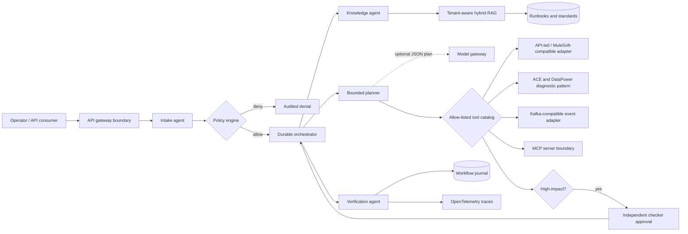
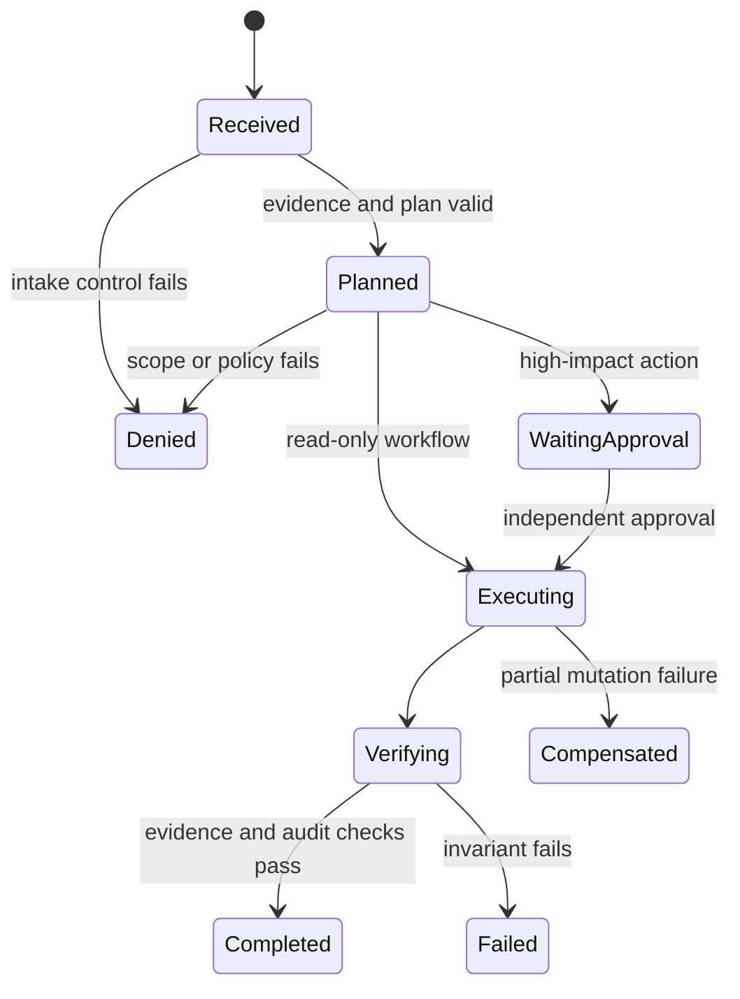

# Enterprise Agentic Integration Fabric

[](https://github.com/Czhari30/enterprise-agentic-integration-fabric/actions/workflows/ci.yml)
[](https://www.python.org/)
[](LICENSE)

**A governed agentic AI reference platform for complex enterprise integration workflows.**

This project shows how a regulated organization can connect LLM-assisted reasoning to existing
APIs, integration runtimes and event streams without giving a model uncontrolled access to them.
It combines tenant-aware hybrid RAG, a bounded multi-agent workflow, policy gates, durable state,
human approval, synthetic enterprise connectors, MCP exposure, container hardening and
OpenTelemetry-compatible traces.

> All workflows, identities, documents and transactions are synthetic. This repository contains
> no employer source code, architecture, credentials, customer data or confidential operating detail.

## Why this is more than an agent demo

| Enterprise concern | Implemented control |
|---|---|
| Agent hallucination | The model may suggest only registered tools; code performs execution |
| Data isolation | Tenant and clearance filters run before retrieval |
| High-impact actions | Maker-checker approval pauses the durable workflow |
| Duplicate delivery | Workflow and tool execution use idempotency keys |
| Partial failure | Mutations return compensating tokens for saga recovery |
| Auditability | SQLite event journal plus redacted OpenTelemetry-compatible spans |
| Prompt injection | Injection markers are rejected before planning |
| Evidence quality | Hybrid retrieval produces validated `knowledge://` citations |
| Integration reuse | API-led, MCP-style and event-adapter boundaries wrap existing services |
| Container security | Non-root, read-only filesystem, dropped capabilities and NetworkPolicy |

## Architecture



The workflow is intentionally hybrid. An LLM can help interpret intent and choose from a small
catalog, while authorization, idempotency, approval, execution and verification remain deterministic.
The application operates fully offline by default; an OpenAI-compatible model endpoint is optional.

## Reference workflow

The included scenario investigates a synthetic payment timeout:

1. Intake checks tenant context and prompt-injection patterns.
2. Hybrid RAG retrieves policy-visible runbooks with citations.
3. The planner selects payment lookup, distributed trace correlation and safe replay tools.
4. Scope and risk policies evaluate every proposed call.
5. A high-value replay pauses at a durable approval checkpoint.
6. A different checker approves; idempotent tools execute once.
7. The verifier checks evidence, approvals and results before completion.
8. The journal and trace stream preserve an auditable decision path without prompt contents.



## Run locally

### Containers

```bash
docker compose up --build
```

- Operator dashboard: <http://localhost:8080>
- OpenAPI documentation: <http://localhost:8080/docs>
- Jaeger traces: <http://localhost:16686>

### Python

```bash
python -m venv .venv
source .venv/bin/activate
python -m pip install -e ".[dev]"
uvicorn enterprise_fabric.api:app --reload --port 8080
```

The core orchestration and all tests use only the Python standard library. FastAPI, MCP and
OpenTelemetry are boundary dependencies.

## Try the governed API

```bash
curl -s http://localhost:8080/v1/workflows \
  -H 'Content-Type: application/json' \
  -H 'X-Tenant-Id: tenant-a' \
  -H 'X-Subject: maker-01' \
  -H 'X-Roles: operator' \
  -H 'X-Clearance: restricted' \
  -H 'X-Scopes: payments:read,integration:read,integration:write' \
  -d '{
    "request_id": "case-2026-001",
    "idempotency_key": "case-2026-001-v1",
    "intent": "Investigate the payment timeout and safely replay the message",
    "amount": 25000,
    "currency": "MYR",
    "metadata": {"payment_ref": "PAY-DEMO-1042", "message_id": "MSG-DEMO-77"}
  }'
```

The response pauses at `waiting_approval`. Approve with a separate subject carrying the
`approver` role:

```bash
curl -s -X POST http://localhost:8080/v1/workflows/WF_ID/approve \
  -H 'Content-Type: application/json' \
  -H 'X-Tenant-Id: tenant-a' \
  -H 'X-Subject: checker-02' \
  -H 'X-Roles: approver' \
  -H 'X-Clearance: restricted' \
  -H 'X-Scopes: payments:read,integration:read,integration:write' \
  -d '{"approval_reference": "APR-2026-0001"}'
```

## Optional model and MCP boundaries

Set `MODEL_BASE_URL`, `MODEL_API_KEY` and `MODEL_NAME` to enable the constrained model gateway.
The gateway accepts JSON tool suggestions only and rejects any tool outside the registry. It never
executes the suggestion directly.

Install the optional MCP dependency and expose the narrow read-only tools:

```bash
python -m pip install -e ".[mcp]"
python -m enterprise_fabric.mcp_server
```

The [MuleSoft capability map](deploy/mulesoft/capability-map.yaml) explains how the same project
boundaries map conceptually to discovery, governance, orchestration, observation, MCP Bridge and
API-led connectivity. It is intentionally not presented as a deployable proprietary configuration.

## Evaluation and verification

```bash
python -m unittest discover -s tests -v
python evaluation/run.py
python -m compileall -q enterprise_fabric tests evaluation
```

The suite covers successful investigations, approval checkpoints, maker-checker separation,
tenant isolation, clearance filters, missing scopes, prompt injection, telemetry redaction,
idempotency, durable recovery and hallucinated tool rejection.

## Deployment assets

- [Docker Compose stack](compose.yaml): application, OpenTelemetry Collector and Jaeger.
- [Hardened Kubernetes deployment](deploy/kubernetes/platform.yaml): native sidecar, restricted pod
  security, probes, resource limits, HPA, PDB and NetworkPolicy.
- [Policy-as-code example](policies/agent-policy.yaml): identity, retrieval, model, approval and tool rules.
- [Synthetic OpenAPI contract](contracts/payments.openapi.yaml): API-led/MCP bridge candidate.
- [Threat model](docs/THREAT_MODEL.md): trust boundaries, abuse cases and residual risks.
- [Architecture decisions](docs/ARCHITECTURE.md): why deterministic controls wrap probabilistic reasoning.

## Technology direction

The design follows current official platform direction rather than a fictional bank architecture:

- MuleSoft Agent Fabric separates **discover, govern, orchestrate and observe**, and exposes existing
  APIs to agents through MCP Bridge and MCP Connector.
- OpenTelemetry defines GenAI attributes for agents, retrieval, tool execution, evaluation and workflows.
- Kubernetes native sidecars are stable from v1.33 and support lifecycle-aware telemetry collection.
- MCP and A2A-style boundaries let tools and agents remain replaceable across model vendors.

See [REFERENCES.md](docs/REFERENCES.md) for primary documentation.

## Scope and production gaps

This is a portfolio-quality reference implementation, not a production banking system. A real
deployment would replace SQLite with a replicated workflow/event store, integrate enterprise IAM
and secrets management, use signed artifacts and private registries, constrain egress to explicit
destinations, connect approved model gateways, and complete threat modelling, load testing,
penetration testing and regulatory review.

## License

[MIT](LICENSE) © 2026 Mohanahari Mohan
